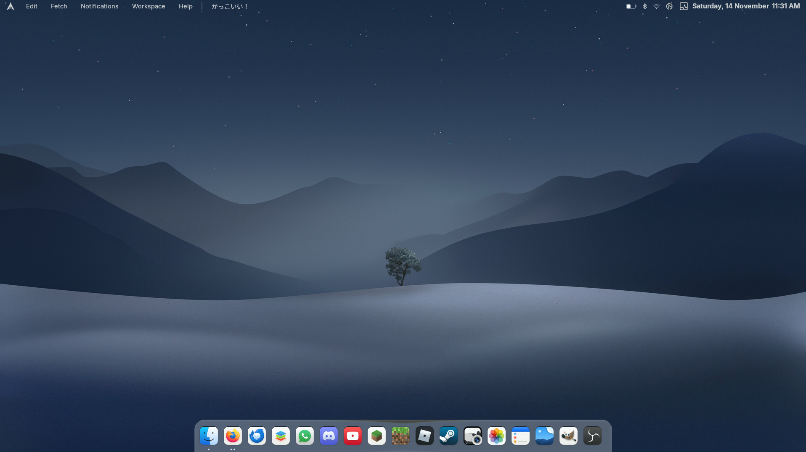
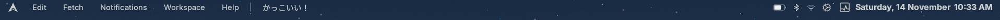
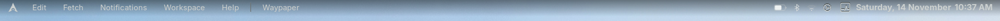
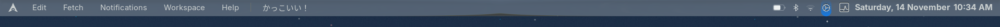
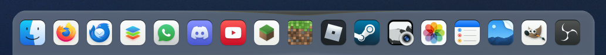
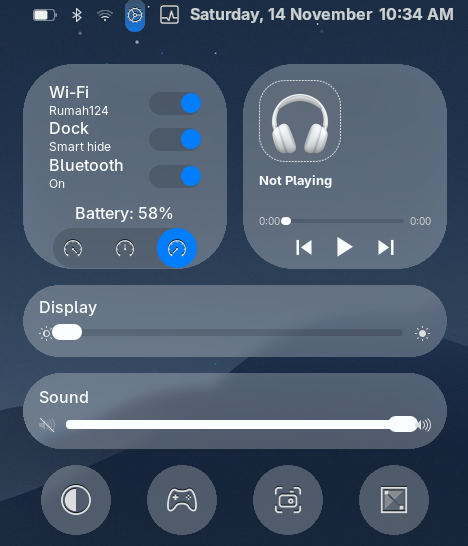
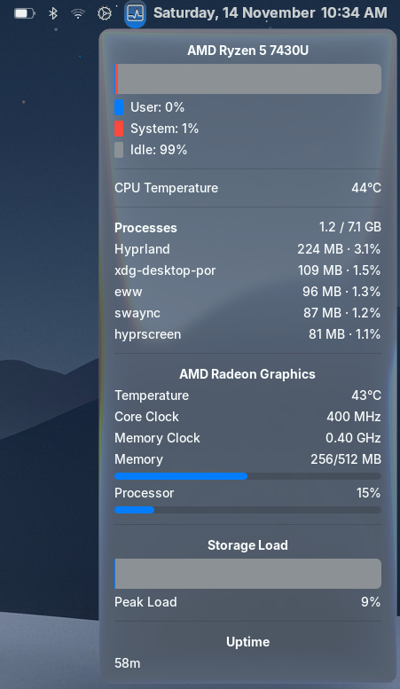
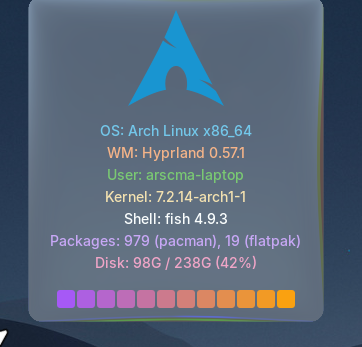

# eww-mac-shell 🍎

A macOS-style desktop shell for **Hyprland**, built with [EWW](https://github.com/elkowar/eww).



---

## 📸 Screenshots

### Panel


### Panel Variations




### Dock


### Control Center


### System Monitor


### Fetch


---

## 🎬 Showcase

[▶ Watch the full showcase video](https://github.com/Arscma/eww-mac-shell/releases/download/v1.0.0/ewwmacosshowcase.mp4)

---

## ✨ Features

- macOS-inspired panel, dock, and menus
- Light and Dark theme switcher
- Gaming mode with Waybar
- Integrated applications:
  - SwayNotificationCenter
  - nwg-drawer
  - Hyprlock
  - Waybar
- Customizable dock with pinned applications
- System monitor, media controls, calendar, and other widgets
- Optional Hyprland plugin integration

---

## 📦 Dependencies

The following packages are required for the complete setup.

<details>
<summary><strong>Expand dependency list</strong></summary>

### Official repositories (pacman)

```bash
eww
jq
socat
foot
swaync
nwg-drawer
hyprlock
hypridle
waybar
pavucontrol
pcmanfm
networkmanager
bluez
brightnessctl
pipewire-pulse
playerctl
power-profiles-daemon
pacman-contrib
curl
grim
hyprpolkitagent
waypaper
ttf-jetbrains-mono-nerd
```

### AUR (yay)

```bash
whitesur-icon-theme
bibata-cursor-theme
ttf-inter
ttf-bebas-neue
nerd-fonts-symbols-only
```

### Required fonts

- Inter
- Bebas Neue
- Symbols Nerd Font
- JetBrainsMono Nerd Font

</details>

---

## 🚀 Installation

> **Note:** This setup is designed for Hyprland on Arch Linux. Some components and commands may need adjustments on other distributions.

### 1. Clone the repository

```bash
git clone https://github.com/Arscma/eww-mac-shell
cd eww-mac-shell
```

### 2. Install dependencies

```bash
chmod +x install.sh
./install.sh
```

### 3. Copy the EWW configuration

```bash
mkdir -p ~/.config/eww

cp -r assets scripts apps *.yuck *.scss \
    ~/.config/eww/
```

### 4. Set up symbolic links

```bash
# For nwg-drawer:

ln -sfn ~/.config/eww/apps/nwg-drawer/drawer-dark.css \
    ~/.config/eww/apps/nwg-drawer/drawer.css

# For SwayNotificationCenter:

ln -sfn ~/.config/eww/apps/swaync/style-dark.css \
    ~/.config/eww/apps/swaync/style.css
```

### 5. Make scripts executable

```bash
chmod +x ~/.config/eww/scripts/bin/*
chmod +x ~/.config/eww/scripts/*.sh
chmod +x ~/.config/eww/apps/swaync/scripts/*.sh
```

### 6. Start EWW

```bash
~/.config/eww/scripts/startandrestart.sh
```

---

## 🔌 Hyprland Integration

Hyprland integration is optional. Choose the setup that matches your situation.

- **Block 1 — Plugins + config:** For users who already have a Hyprland configuration and only want to add the plugins and EWW-related integration.
- **Block 2 — Full integration:** For a fresh Hyprland setup. This includes the complete `hyprland.lua` configuration, including monitors, animations, keybindings, plugins, and autostart.

<details>
<summary><strong>Block 1 — Plugins + config (existing Hyprland setup)</strong></summary>

### Install the plugins

Run these commands:

```bash
hyprpm add https://github.com/hyprwm/hyprland-plugins
hyprpm add https://github.com/hyprnux/HyprGlass
hyprpm add https://github.com/VirtCode/hyprland-dynamic-cursors
hyprpm add https://github.com/sandwichfarm/hyprexpo
hyprpm enable hyprbars hyprexpo hyprglass dynamic-cursors
```

### Add the plugin configuration

Make sure your existing Hyprland configuration has initialized the hl API before adding this configuration.
Paste the following into your existing `hyprland.lua` configuration:

```lua
--------------------------
---- PLUGIN: HYPRGLASS ----
--------------------------

if hl.plugin.hyprglass then
    local hg = hl.plugin.hyprglass

    hg.preset("glass", { refraction_strength = 8.0, chromatic_aberration = 0.5 })

    hg.config({
        enabled = false,
        default_theme = "light",
        default_preset = "glass",
        tint_color = 0x8899aa22,

        brightness = 1,
        dark = { brightness = 0.89 },
        light = { adaptive_boost = 0.5 },

        layers = { enabled = true },
    })

    -- Layer surfaces: each call whitelists the namespace and configures it
    -- hg.layer("waybar", { preset = "glass", mask_threshold = 0.09 })
    -- hg.layer("wofi", { preset = "glass", mask_threshold = 0.05 })
    hg.layer("nwg-drawer", { preset = "glass", mask_threshold = 0.05 })
    hg.layer("eww-panel", { preset = "glass", mask_threshold = 0.05 })
    hg.layer("eww-menu", { preset = "glass", mask_threshold = 0.01 })
    hg.layer("eww-dock", { preset = "glass", mask_threshold = 0.05 })
    hg.layer("eww-sysstat", { preset = "glass", mask_threshold = 0.05 })
    hg.layer("eww-control-center", { preset = "glass", mask_threshold = 0.05 })
    hg.layer("eww-clock-widget", { preset = "glass", mask_threshold = 0.05 })
    hg.layer("eww-calendar-widget", { preset = "glass", mask_threshold = 0.05 })
    hg.layer("eww-weather-widget", { preset = "glass", mask_threshold = 0.05 })
    hg.layer("eww-help-menu", { preset = "glass", mask_threshold = 0.05 })
    hg.layer("eww-dt-menu", { preset = "glass", mask_threshold = 0.05 })
    hg.layer("eww-fetch", { preset = "glass", mask_threshold = 0.05 })

    hg.layer("swaync-notification-window", {
        preset = "glass",
        mask_mode = "alpha",
        mask_threshold = 0.05,
    })

    hg.layer("swaync-control-center", {
        preset = "glass",
        mask_mode = "alpha",
        mask_threshold = 0.05,
    })
end

--------------------------
---- PLUGIN: HYPRBARS ----
--------------------------

if hl.plugin and hl.plugin.hyprbars then
    hl.config({
        plugin = {
            hyprbars = {
                bar_color = "#363a39bf",
                bar_height = 20,
                bar_text_align = "center",
                bar_buttons_alignment = "left",
                bar_button_padding = 8,
                icon_on_hover = true,

                ["col.text"] = "#ffffffff",
                bar_text_font = "Inter",
                bar_text_size = 10,
                on_double_click = [[hyprctl dispatch 'hl.dsp.window.float({ action = "toggle" })']],
                -- on_double_click = [[hyprctl dispatch 'hl.dsp.window.fullscreen({ mode = "maximized", action = "toggle" })']],
            },
        },
    })

    -- Red: close
    hl.plugin.hyprbars.add_button({
        bg_color = "rgb(ff5f57)",
        fg_color = "rgb(4d0000)",
        size = 13,
        icon = "x",
        action = "hyprctl dispatch 'hl.dsp.window.close()'",
    })

    -- Yellow: minimize (window is sent to special workspace "minimized")
    hl.plugin.hyprbars.add_button({
        bg_color = "rgb(febc2e)",
        fg_color = "rgb(5a3a00)",
        size = 13,
        icon = "-",
        action = os.getenv("HOME") .. "/.config/eww/scripts/bin/hyprland-minimize minimize",
    })

    -- Green: maximize
    hl.plugin.hyprbars.add_button({
        bg_color = "rgb(28c840)",
        fg_color = "rgb(003a00)",
        size = 13,
        icon = "+",
        action = [[hyprctl dispatch 'hl.dsp.window.float({ action = "toggle" })']],
        -- action = [[hyprctl dispatch 'hl.dsp.window.fullscreen({ mode = "maximized", action = "toggle" })']],
    })
end

--------------------------
---- PLUGIN: HYPREXPO ----
--------------------------

hl.bind("SUPER + Tab", function()
    if hl.plugin and hl.plugin.hyprexpo then
        hl.plugin.hyprexpo.expo("toggle")
    end
end)

if hl.plugin and hl.plugin.hyprexpo then
    hl.config({
        plugin = {
            hyprexpo = {
                label_enable = 0,
                columns = 2,
                gaps_in = 5,
                gaps_out = 0,
                bg_col = "rgb(000000)",
                workspace_method = "center current",
                gesture_distance = 200,
                cancel_key = "escape",
                show_cursor = 1,
                border_color_current = "rgb(000000)",
                border_color_hover = "rgb(255255)",
                border_color_focus = "rgb(000000)",
            },
        },
    })
end

--------------------------
-- PLUGIN: DYNAMIC CURSOR
--------------------------

if hl.plugin and hl.plugin.dynamic_cursors then
    hl.config({
        plugin = {
            dynamic_cursors = {
                enabled = true,
                mode = "rotate", -- tilt | rotate | stretch | none
                threshold = 2,

                shake = {
                    enabled = false, -- shake mouse = big cursor
                    base = 4.0, -- first transform
                    timeout = 2000, -- big cursor duration
                },
            },
        },
    })
end

hl.layer_rule({
    match = { namespace = "nwg-drawer" },
    name = "drawer-slide",
    animation = "slide top",
})

hl.layer_rule({
    match = { namespace = "swaync-control-center" },
    animation = "slide",
})

-- Disable hyprbars for apps that have their own titlebar
-- hl.window_rule({ match = { class = "ONLYOFFICE" }, ["hyprbars:no_bar"] = true })
-- hl.window_rule({ match = { class = "steam" }, ["hyprbars:no_bar"] = true })
-- hl.window_rule({ match = { class = "com.betterstickies.BetterStickies" }, ["hyprbars:no_bar"] = true })
```

</details>

<details>
<summary><strong>Block 2 — Full integration (fresh Hyprland setup)</strong></summary>

This block is intended to be used as your complete `hyprland.lua` configuration. Review the monitor names, resolutions, and positions near the top and adjust them for your hardware before using it.

```lua
hl.monitor({
    output = "eDP-1",
    mode = "1920x1080@60",
    position = "0x0",
    scale = 1,
})

hl.monitor({
    output = "HDMI-A-1",
    mode = "1920x1080@60",
    position = "0x-1920",
    scale = 1,
    transform = 3,
})

-------------------
---- AUTOSTART ----
-------------------

local function autostart(bin, cmd)
    hl.exec_cmd("command -v " .. bin .. " >/dev/null 2>&1 && " .. (cmd or bin))
end

hl.on("hyprland.start", function()
    hl.exec_cmd("sleep 3 && ~/.config/eww/apps/Hyprlock/lock.sh")
    hl.exec_cmd("systemctl --user start hyprpolkitagent")
    autostart("hypridle")
    autostart("swaync", "swaync -c ~/.config/eww/apps/swaync/config.json -s ~/.config/eww/apps/swaync/style.css")
    hl.exec_cmd("sleep 4; " .. os.getenv("HOME") .. "/.config/eww/scripts/apply-blur.sh")
    autostart("waypaper", "sleep 1 && waypaper --restore")
end)

-------------------------------
---- ENVIRONMENT VARIABLES ----
-------------------------------

hl.env("XCURSOR_THEME", "Bibata-Modern-Ice")
hl.env("XCURSOR_SIZE", "24")
hl.env("HYPRCURSOR_THEME", "Bibata-Modern-Ice")
hl.env("HYPRCURSOR_SIZE", "24")

-----------------------
---- LOOK AND FEEL ----
-----------------------

hl.config({
    general = {
        gaps_in = 5,
        gaps_out = 3,

        border_size = 0,

        col = {
            active_border = "rgba(4c4c4cee)",
            inactive_border = "rgba(2a2a2aaa)",
        },

        layout = "dwindle",
    },

    decoration = {
        rounding = 8,

        active_opacity = 1.0,
        inactive_opacity = 1.0,

        shadow = {
            enabled = false,
            range = 0,
            color = 0x00000000,
        },

        blur = {
            enabled = false,
            size = 3,
            passes = 1,
            vibrancy = 0.1696,
        },
    },

    animations = {
        enabled = true,
    },
})

input = {
    touchpad = {
        natural_scroll = true,
        scroll_factor = 1.5,
    },
    sensitivity = 1.0,
}

----------------------
---- ANIMATIONS ------
----------------------

hl.curve("smoothBounce", {
    type = "bezier",
    points = { {0.15, 0.85}, {0.2, 1.08} },
})

hl.curve("linear", {
    type = "bezier",
    points = { {0, 0}, {1, 1} },
})

hl.animation({
    leaf = "windowsIn",
    enabled = true,
    speed = 3.5,
    bezier = "smoothBounce",
    style = "slide bottom",
})

hl.animation({
    leaf = "windowsOut",
    enabled = true,
    speed = 3,
    bezier = "smoothBounce",
    style = "slide top",
})

hl.animation({
    leaf = "windowsMove",
    enabled = true,
    speed = 3.5,
    bezier = "smoothBounce",
})

hl.animation({ leaf = "fadeIn", enabled = true, speed = 3, bezier = "linear" })
hl.animation({ leaf = "fadeOut", enabled = true, speed = 3, bezier = "linear" })
hl.animation({ leaf = "fadeSwitch", enabled = true, speed = 3, bezier = "linear" })
hl.animation({ leaf = "fadeDim", enabled = true, speed = 3, bezier = "linear" })

hl.animation({
    leaf = "workspaces",
    enabled = true,
    speed = 5.5,
    bezier = "smoothBounce",
    style = "slidevert",
})

hl.animation({ leaf = "border", enabled = false, speed = 1, bezier = "linear" })
hl.animation({ leaf = "borderangle", enabled = false, speed = 1, bezier = "linear" })

----------------------
-- LAYOUT (DWINDLE) --
----------------------

hl.config({
    decoration = {
        wobble = {
            enabled = false,
            mesh = 16,
            stiffness = 120,
            damping = 7,
            mass = 1,
            intensity = 0.34,
        },
    },
})

hl.config({
    dwindle = {
        preserve_split = true,
        smart_split = true,
        force_split = 0,
    },
})

----------------
---- MISC ----
----------------

hl.config({
    misc = {
        force_default_wallpaper = -1,
        disable_hyprland_logo = false,
    },
})

---------------
---- INPUT ----
---------------

hl.config({
    input = {
        kb_layout = "us",
        kb_variant = "",
        kb_model = "",
        kb_options = "",
        kb_rules = "",

        follow_mouse = 1,

        sensitivity = 0, -- -1.0 - 1.0, 0 = no modification

        touchpad = {
            natural_scroll = false,
        },
    },
})

---------------------
---- KEYBINDINGS ----
---------------------

local mainMod = "SUPER"
local closeWindowBind = hl.bind(mainMod .. " + Escape", hl.dsp.window.close())

hl.bind(mainMod .. " + P", hl.dsp.window.pseudo())
hl.bind(mainMod .. " + J", hl.dsp.layout("togglesplit")) -- dwindle only

-- Find the remaining keybindings yourself :)

-- Move focus with mainMod + arrow keys
hl.bind(mainMod .. " + left", hl.dsp.focus({ direction = "left" }))
hl.bind(mainMod .. " + right", hl.dsp.focus({ direction = "right" }))
hl.bind(mainMod .. " + up", hl.dsp.focus({ direction = "up" }))
hl.bind(mainMod .. " + down", hl.dsp.focus({ direction = "down" }))

-- Switch workspaces with mainMod + [0-9]
-- Move active window to a workspace with mainMod + SHIFT + [0-9]
for i = 1, 10 do
    local key = i % 10 -- 10 maps to key 0
    hl.bind(mainMod .. " + " .. key, hl.dsp.focus({ workspace = i }))
    hl.bind(mainMod .. " + SHIFT + " .. key, hl.dsp.window.move({ workspace = i }))
end

-- Example special workspace (scratchpad)
hl.bind(mainMod .. " + M", hl.dsp.workspace.toggle_special("minimized"))

hl.bind(mainMod .. " + SHIFT + M", function()
    hl.exec_cmd(os.getenv("HOME") .. "/.config/eww/scripts/bin/hyprland-minimize minimize")
end)

-- Scroll through existing workspaces with mainMod + scroll
hl.bind(mainMod .. " + mouse_down", hl.dsp.focus({ workspace = "e+1" }))
hl.bind(mainMod .. " + mouse_up", hl.dsp.focus({ workspace = "e-1" }))

-- Move/resize windows with mainMod + LMB/RMB and dragging
hl.bind(mainMod .. " + mouse:272", hl.dsp.window.drag(), { mouse = true })
hl.bind(mainMod .. " + mouse:273", hl.dsp.window.resize(), { mouse = true })

hl.gesture({
    fingers = 3,
    direction = "swipe",
    mods = "SUPER",
    action = "resize",
})

-- Laptop multimedia keys for volume and LCD brightness
hl.bind("XF86AudioRaiseVolume", hl.dsp.exec_cmd("wpctl set-volume -l 1 @DEFAULT_AUDIO_SINK@ 5%+"), { locked = true, repeating = true })
hl.bind("XF86AudioLowerVolume", hl.dsp.exec_cmd("wpctl set-volume @DEFAULT_AUDIO_SINK@ 5%-"), { locked = true, repeating = true })
hl.bind("XF86AudioMute", hl.dsp.exec_cmd("wpctl set-mute @DEFAULT_AUDIO_SINK@ toggle"), { locked = true, repeating = true })
hl.bind("XF86AudioMicMute", hl.dsp.exec_cmd("wpctl set-mute @DEFAULT_AUDIO_SOURCE@ toggle"), { locked = true, repeating = true })
hl.bind("XF86MonBrightnessUp", hl.dsp.exec_cmd("brightnessctl -e4 -n2 set 5%+"), { locked = true, repeating = true })
hl.bind("XF86MonBrightnessDown", hl.dsp.exec_cmd("brightnessctl -e4 -n2 set 5%-"), { locked = true, repeating = true })

-- Requires playerctl
hl.bind("XF86AudioNext", hl.dsp.exec_cmd("playerctl next"), { locked = true })
hl.bind("XF86AudioPause", hl.dsp.exec_cmd("playerctl play-pause"), { locked = true })
hl.bind("XF86AudioPlay", hl.dsp.exec_cmd("playerctl play-pause"), { locked = true })
hl.bind("XF86AudioPrev", hl.dsp.exec_cmd("playerctl previous"), { locked = true })

--------------------------------
---- WINDOWS AND WORKSPACES ----
--------------------------------

hl.window_rule({
    name = "float-everything",
    match = { class = ".*" },
    float = true,
    center = true,
})

hl.window_rule({
    name = "fix-firefox-size",
    match = { class = "^org.mozilla.firefox$" },
    size = { 1200, 800 },
})

hl.window_rule({
    name = "suppress-maximize-events",
    match = { class = ".*" },
    suppress_event = "maximize",
})

hl.window_rule({
    name = "fix-xwayland-drags",
    match = {
        class = "^$",
        title = "^$",
        xwayland = true,
        float = true,
        fullscreen = false,
        pin = false,
    },
    no_focus = true,
})

--------------------------
---- PLUGIN: HYPRGLASS ----
--------------------------

if hl.plugin.hyprglass then
    local hg = hl.plugin.hyprglass

    hg.preset("glass", { refraction_strength = 8.0, chromatic_aberration = 0.5 })

    hg.config({
        enabled = false,
        default_theme = "light",
        default_preset = "glass",
        tint_color = 0x8899aa22,

        brightness = 1,
        dark = { brightness = 0.89 },
        light = { adaptive_boost = 0.5 },

        layers = { enabled = true },
    })

    -- Layer surfaces: each call whitelists the namespace and configures it
    -- hg.layer("waybar", { preset = "glass", mask_threshold = 0.09 })
    -- hg.layer("wofi", { preset = "glass", mask_threshold = 0.05 })
    hg.layer("nwg-drawer", { preset = "glass", mask_threshold = 0.05 })
    hg.layer("eww-panel", { preset = "glass", mask_threshold = 0.05 })
    hg.layer("eww-menu", { preset = "glass", mask_threshold = 0.01 })
    hg.layer("eww-dock", { preset = "glass", mask_threshold = 0.05 })
    hg.layer("eww-sysstat", { preset = "glass", mask_threshold = 0.05 })
    hg.layer("eww-control-center", { preset = "glass", mask_threshold = 0.05 })
    hg.layer("eww-clock-widget", { preset = "glass", mask_threshold = 0.05 })
    hg.layer("eww-calendar-widget", { preset = "glass", mask_threshold = 0.05 })
    hg.layer("eww-weather-widget", { preset = "glass", mask_threshold = 0.05 })
    hg.layer("eww-help-menu", { preset = "glass", mask_threshold = 0.05 })
    hg.layer("eww-dt-menu", { preset = "glass", mask_threshold = 0.05 })
    hg.layer("eww-fetch", { preset = "glass", mask_threshold = 0.05 })

    hg.layer("swaync-notification-window", {
        preset = "glass",
        mask_mode = "alpha",
        mask_threshold = 0.05,
    })

    hg.layer("swaync-control-center", {
        preset = "glass",
        mask_mode = "alpha",
        mask_threshold = 0.05,
    })
end

--------------------------
---- PLUGIN: HYPRBARS ----
--------------------------

if hl.plugin and hl.plugin.hyprbars then
    hl.config({
        plugin = {
            hyprbars = {
                bar_color = "#363a39bf",
                bar_height = 20,
                bar_text_align = "center",
                bar_buttons_alignment = "left",
                bar_button_padding = 8,
                icon_on_hover = true,

                ["col.text"] = "#ffffffff",
                bar_text_font = "Inter",
                bar_text_size = 10,
                on_double_click = [[hyprctl dispatch 'hl.dsp.window.float({ action = "toggle" })']],
                -- on_double_click = [[hyprctl dispatch 'hl.dsp.window.fullscreen({ mode = "maximized", action = "toggle" })']],
            },
        },
    })

    -- Red: close
    hl.plugin.hyprbars.add_button({
        bg_color = "rgb(ff5f57)",
        fg_color = "rgb(4d0000)",
        size = 13,
        icon = "x",
        action = "hyprctl dispatch 'hl.dsp.window.close()'",
    })

    -- Yellow: minimize
    hl.plugin.hyprbars.add_button({
        bg_color = "rgb(febc2e)",
        fg_color = "rgb(5a3a00)",
        size = 13,
        icon = "-",
        action = os.getenv("HOME") .. "/.config/eww/scripts/bin/hyprland-minimize minimize",
    })

    -- Green: maximize
    hl.plugin.hyprbars.add_button({
        bg_color = "rgb(28c840)",
        fg_color = "rgb(003a00)",
        size = 13,
        icon = "+",
        action = [[hyprctl dispatch 'hl.dsp.window.float({ action = "toggle" })']],
        -- action = [[hyprctl dispatch 'hl.dsp.window.fullscreen({ mode = "maximized", action = "toggle" })']],
    })
end

--------------------------
---- PLUGIN: HYPREXPO ----
--------------------------

hl.bind(mainMod .. " + Tab", function()
    if hl.plugin and hl.plugin.hyprexpo then
        hl.plugin.hyprexpo.expo("toggle")
    end
end)

if hl.plugin and hl.plugin.hyprexpo then
    hl.config({
        plugin = {
            hyprexpo = {
                label_enable = 0,
                columns = 2,
                gaps_in = 5,
                gaps_out = 0,
                bg_col = "rgb(000000)",
                workspace_method = "center current",
                gesture_distance = 200,
                cancel_key = "escape",
                show_cursor = 1,
                border_color_current = "rgb(000000)",
                border_color_hover = "rgb(255255)",
                border_color_focus = "rgb(000000)",
            },
        },
    })
end

--------------------------
-- PLUGIN: DYNAMIC CURSOR
--------------------------

if hl.plugin and hl.plugin.dynamic_cursors then
    hl.config({
        plugin = {
            dynamic_cursors = {
                enabled = true,
                mode = "rotate", -- tilt | rotate | stretch | none
                threshold = 2,

                shake = {
                    enabled = false, -- shake mouse = big cursor
                    base = 4.0, -- first transform
                    timeout = 2000, -- big cursor duration
                },
            },
        },
    })
end

hl.layer_rule({
    match = { namespace = "nwg-drawer" },
    name = "drawer-slide",
    animation = "slide top",
})

hl.layer_rule({
    match = { namespace = "swaync-control-center" },
    animation = "slide",
})

-- Disable hyprbars for apps that have their own titlebar
-- hl.window_rule({ match = { class = "ONLYOFFICE" }, ["hyprbars:no_bar"] = true })
-- hl.window_rule({ match = { class = "steam" }, ["hyprbars:no_bar"] = true })
-- hl.window_rule({ match = { class = "com.betterstickies.BetterStickies" }, ["hyprbars:no_bar"] = true })
```

</details>

---

## ⚙️ Dock Pinned Apps

The dock's pinned applications are configured by you.

Edit this file:

~/.config/eww/scripts/status/pinned.json

Add, remove, or modify entries to customize the applications shown in your dock.

---

## ⚠️ Known Issues

- The `drawer-light.css` and `drawer-dark.css` filenames are currently swapped in terms of their actual theme contents. The theme switcher accounts for this, so the appearance works as intended; only the filenames are inverted.

---

## 🙏 Credits

- [eww](https://github.com/elkowar/eww)
- [WhiteSur Icon Theme](https://github.com/vinceliuice/WhiteSur-icon-theme)
